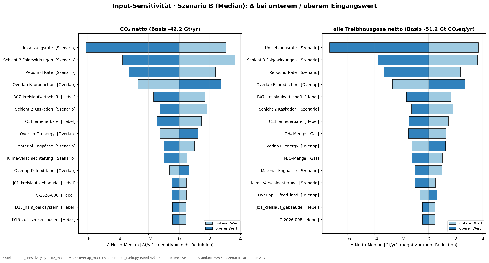

# Input-Sensitivität pro Hebel (Roadmap Paket 1)

**Stand:** 2026-10-14 · **Charakter:** Studie (reproduzierbar, seed 42) · **Roadmap:** [`canon/decisions/DEC_2026-10-14_roadmap_external_validation.md`](../../canon/decisions/DEC_2026-10-14_roadmap_external_validation.md) Paket 1
**Reproduzierbar:** `python studies/INPUT_SENSITIVITY_2026-10-14/input_sensitivity.py` → `results.txt`, `tornado_co2_ghg.csv`, `variance_levers.csv`, `Figure_Tornado(.png/.svg)`, `Figure_Tornado_EN(.png/.svg)`

> **Note for external readers (EN):** One-at-a-time tornado analysis of all model inputs (41 lever values, 3 overlap amounts, 6 scenario parameters, 3 gas amounts) on the scenario-B net median, using the same Monte-Carlo draws as the headline (seed 42), plus a variance decomposition of layer-1 input uncertainty per lever. All inputs are read from `canon/data/*.yaml`; nothing is hard-coded. Ranges come from the data files or a documented default (±25 %).

## 1. Frage

Welche Eingangswerte treiben die Netto-Ergebnisse (CO₂ netto −42,2 Gt/a; alle Treibhausgase netto −51,2 Gt CO₂eq/a, jeweils Szenario B) am stärksten? Daraus folgt, wo externe Belege (Pakete 2–4) am meisten bewirken.

## 2. Methode

| Baustein | Umsetzung |
|---|---|
| Tornado | Jede Eingangsgröße einzeln auf ihren unteren bzw. oberen Wert, alle anderen auf Basis. Monte-Carlo mit **identischen Zufallsziehungen** wie `monte_carlo.py` (der Basiswert reproduziert die Headline exakt, per `assert` geprüft). Ergebnis: Δ des Medians von Szenario B. |
| Eingangsgrößen | 41 Hebel-Werte (40 Hebel + 1 Community, `co2_master.yaml`) · 3 Overlap-Beträge (`overlap_matrix.yaml`) · 6 Szenario-Parameter (`monte_carlo.py`) · 3 Gasmengen (`impact_master.yaml`, nur all-GHG) |
| Bandbreiten Hebel | „Bandbreite X bis Y“ aus dem YAML-Kommentar, wo vorhanden (6 Hebel: B13, D19, K01–K04). Sonst **Standard ±25 %** = die dokumentierte Gesamtunsicherheit (`co2_master.yaml` → `uncertainty_assessment.propagation`) |
| Hebel in Overlap-Gruppen | wirken anteilig mit dem Faktor Gruppen-Netto / Gruppen-Brutto (B 0,46 · C 0,61 · D15/D16 0,56). Die Aufteilung auf Paare ist nicht belegt, deshalb proportional (Annahme) |
| Overlap-Beträge | ±25 % (Standard, gleiche Quelle) |
| Szenario-Parameter | unterer Wert = Szenario A, oberer Wert = Szenario C, alles andere wie B |
| Gasmengen | Unsicherheitsband aus `impact_master.yaml` |
| Varianz-Zerlegung | Schicht-1-Eingangsunsicherheit pro Hebel, analytisch (linear, unabhängige Dreiecksverteilungen) |

## 3. Ergebnisse

### 3.1 Tornado: Top 10 (Swing = Abstand Δ oben ↔ Δ unten, Gt/a)

| Rang | Eingang | Art | CO₂ netto | alle THG netto |
|---:|---|---|---:|---:|
| 1 | Umsetzungsrate (70 % ↔ 85 %) | Szenario | **9,2** | **11,0** |
| 2 | Schicht 3 Folgewirkungen | Szenario | **7,3** | 7,4 |
| 3 | Rebound-Rate (20 % ↔ 8 %) | Szenario | **5,7** | 5,7 |
| 4 | **Overlap Domäne B** (17,0 ± 25 %) | Daten | **5,4** | 5,4 |
| 5 | B07 Kreislaufwirtschaft | Hebel | 3,3 | 3,3 |
| 6 | Schicht 2 Kaskaden | Szenario | 3,1 | 3,1 |
| 7 | C11 Erneuerbare | Hebel | 2,9 | 2,9 |
| 8 | Overlap Domäne C (7,8 ± 25 %) | Daten | 2,5 | 2,5 |
| 9 | Material-Engpässe | Szenario | 2,0 | 2,0 |
| 10 | Klima-Verschlechterung | Szenario | 1,5 | 1,5 |
| | CH₄-Menge / N₂O-Menge | Gas | – | 2,8 / 2,3 |

Vollständige Tabelle: `tornado_co2_ghg.csv` (53 Eingänge).

### 3.2 Varianz-Zerlegung der Hebel-Eingangswerte (Schicht 1)

| Hebel | Anteil |
|---|---:|
| B07 Kreislaufwirtschaft | 42,6 % |
| C11 Erneuerbare | 32,5 % |
| J01 Kreislauf-Gebäude | 3,5 % |
| C-2026-008 Präzisionsfermentation | 3,5 % |
| D17 Hanf-Ökosystem | 3,0 % |
| D16 CO₂-Senken Boden | 3,0 % |
| **Top 3 zusammen** | **78,5 %** |

## 4. Befunde

1. **Annahmen über die Umsetzung schlagen jeden Datenwert.** Umsetzungsrate, Folgewirkungen (Schicht 3) und Rebound bewegen das Ergebnis um 6–11 Gt. Sie sind Szenario-Annahmen und keine Messwerte. Damit ist die größte Unsicherheit eine Frage der Umsetzung, nicht der Hebel-Physik.
2. **Der größte einzelne Daten-Eingang ist ein Overlap, kein Hebel.** Die Doppelzählungs-Bereinigung in Domäne B (17,0 Gt) bewegt das Ergebnis stärker (5,4) als jeder Hebel. Für sie gibt es keine belegten Paar-Koeffizienten (`not_sourced`).
3. **Zwei Hebel tragen drei Viertel der Hebel-Unsicherheit:** B07 Kreislaufwirtschaft und C11 Erneuerbare (zusammen 75 %).
4. **Schicht 3 (Folgewirkungen) ist der zweitstärkste Treiber**, gleichzeitig aber der am wenigsten belegte Teil (Bilanz-Studie §4.6, ±30 %).
5. **Die pauschale Schicht-1-Unsicherheit in `monte_carlo.py` (±10 %) ist eher vorsichtig.** Unabhängig kombinierte Hebel-Bandbreiten ergeben nur σ ≈ 2,9 %. Sind die Fehler der Hebel korreliert (gemeinsame Annahmen), liegt die echte Streuung dazwischen. Die ±10 % bleiben deshalb als konservative Wahl.

## 5. Folgen für die Roadmap

| Paket | Fokus nach diesem Befund |
|---|---|
| 2 Unabhängiger SEC-J-Test | unverändert (betrifft die Bewertung, nicht die Mengen) |
| 3 Rückkopplungen zwischen Domänen | **Schicht 3** und der **Overlap B** zuerst: beide groß und schwach belegt |
| 4 Pilotdaten | **Umsetzungsraten** messen (größter Treiber) und gezielt **B07** und **C11** belegen |

## 6. Grenzen

- Tornado = eine Größe nach der anderen, Wechselwirkungen werden nicht erfasst. Weil das Modell linear-additiv ist, ist der Fehler klein; Umsetzungsrate × Rebound wirken aber multiplikativ.
- Für 35 von 41 Hebeln gilt die Standard-Bandbreite ±25 %. Die Rangfolge hängt deshalb vor allem von der Größe des Hebels ab. Belegte Bandbreiten pro Hebel würden sie schärfen.
- Die anteilige Overlap-Aufteilung ist eine Annahme (Paar-Koeffizienten `not_sourced`).
